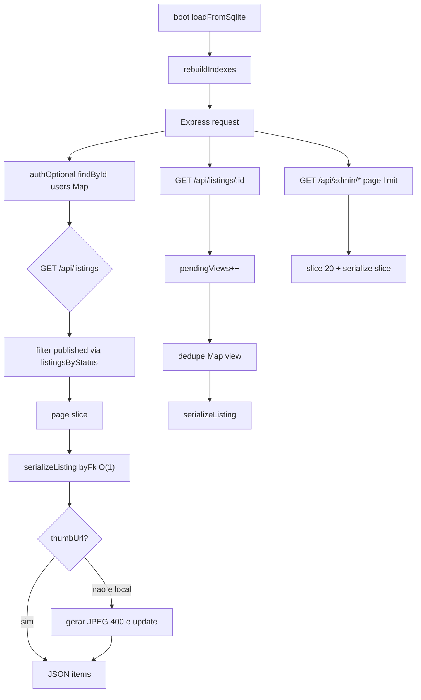
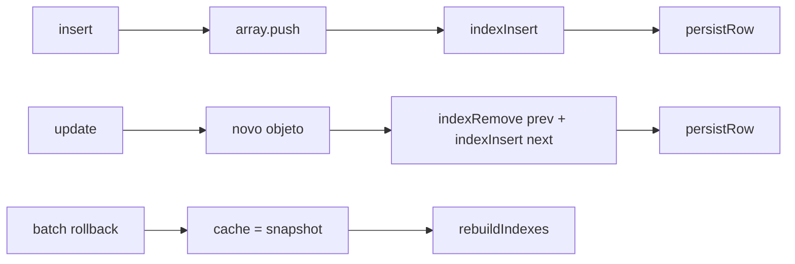

# Catira — arquitetura de performance (Fase 2)

**Data:** 2026-11-05
**Status:** arquitetura e plano. Sem implementação. Sem commit.
**Base:** `docs/superpowers/specs/2026-11-05-performance-audit.md`
**Autorização seguinte:** Fase 5 só com ordem explícita.

---

## Decisões travadas

- Document store em RAM permanece. Sem PostgreSQL nesta fase.
- Índices são Maps no processo, derivados dos arrays. Arrays continuam a fonte persistida.
- Contrato JSON de `serializeListing` não muda (mesmos campos, mesmas permissões).
- Appmax, Pix EMV, VIP, Mercado Livre, `commercialReady`, regras comerciais e Inteligência (fórmulas, tipos de evento, flags) não são reescritos.
- `GET /api/orders` e `GET /api/checkout/sessions` permanecem 403 para o cliente.
- Sem cache de pagamentos, pedidos, saldos, chaves Pix, tokens Appmax.
- Originais de imagem não são apagados.
- Sem biblioteca frontend nova. Uma dependência backend nova é permitida: `sharp`, só para miniaturas.
- Paginação limita o volume **entregue**, não o armazenamento.
- Sem commit/push nesta fase.

---

## 1. Arquitetura proposta

### 1.1 Document store — Maps em memória

Hoje `cache[table]` é um array e `findById` faz `.find` (`backend/src/db.js:261-277`). Mutações já passam por `insert` / `update` / `remove` / `removeWhere` / `reset` / `reload` / `batch` — único lugar seguro para manter índices.

**Estrutura (mesmo processo, mesmo objeto):**

```
byId: Map<tableName, Map<id, rec>>
byFk: Map<`${table}:${fkField}`, Map<fkValue, rec[]>>
usersByEmail: Map<emailLower, rec>
listingsByStatus: Map<status, rec[]>
listingsByUser: Map<userId, rec[]>
```

Índices FK obrigatórios (justificados pela auditoria):

| Tabela | FK | Uso |
|---|---|---|
| `listingImages` | `listingId` | `imagesOf` |
| `listingLikes` | `listingId` | `listingSocialOf` |
| `listingComments` | `listingId` | `listingSocialOf` |
| `listingReviews` | `listingId` | `listingRating` |
| `favorites` | `listingId` | `favoritesCount` |
| `favorites` | `userId` | `GET /api/favorites`, `isFavorited` |
| `listings` | `userId` | mine, `sellerScore`, `listingsCount` |
| `listings` | `status` | GET `/api/listings` |
| `payments` | `listingId` | `listingPayment` |
| `messages` | `conversationId` | chat / unread |
| `users` | `email` (lowercase) | login |

Não indexar nesta fase: `intelligenceEvents` por tipo (vai para mapa de dedupe, secção 6), `orders.appmaxOrderId` (volume baixo; webhook fora de escopo).

**Semântica:**

- O registro no Map **é o mesmo objeto** do array (exceto tabelas protegidas, que continuam a ser clonadas em `all()`).
- `findById(table, id)` lê `byId`. Ausência → `null`. Não varre o array.
- `findWhere` / `all` / `count` sem predicado: array (ou clone protegido), como hoje.
- `count(table, pred)` em caminhos quentes deve ser substituído por `indexSize(table, fk, id)` quando o predicado é igualdade de FK. Predicados arbitrários continuam a filtrar.
- `getCache()` / `persist()` / proteção de pedidos: inalterados.

**Sincronização (obrigatória, senão o índice mente):**

| Operação | Índice |
|---|---|
| `boot` / `reload` | `rebuildIndexes()` depois de `loadFromSqlite()` |
| `insert` | push no array, `indexInsert(rec)` |
| `update` | objeto novo `{...prev, ...patch}`; `indexRemove(prev)` + `indexInsert(next)` se id/FK/email/status mudou; senão substitui a referência no `byId` e no bucket FK |
| `remove` | splice + `indexRemove(rec)` |
| `removeWhere` | para cada removido, `indexRemove` |
| `reset` | `writeAll` + `rebuildIndexes()` |
| `batch` rollback | hoje restaura `cache = snapshot` (`db.js:255`). Depois do restore: **`rebuildIndexes()`**. Não tentar replay. Snapshot profundo dos Maps é mais caro e fácil de errar. |
| `persist()` rewrite-all | arrays já corretos; índices não mudam |

Se `rebuildIndexes` e o array divergirem em teste, o teste falha. Não há “eventual consistency” entre índice e persistência: o SQLite só vê o que `persistRow` já gravou; o índice só vê o que o array já contém, no mesmo tick.

**Inicialização:** `rebuildIndexes` é O(N) no boot, uma vez. Em 100×100 é irrelevante. Critério de migração (secção 7) usa o tempo desta reconstrução.

**API interna nova (nomes estáveis para a Fase 5):**

```js
db.findById(table, id)           // Map
db.byFk(table, field, value)     // rec[] (array vivo ou cópia rasa; não mutar sem insert/update/remove)
db.indexSize(table, field, value)
db.rebuildIndexes()              // testes / rollback
```

Não exportar os Maps crus para rotas.

### 1.2 `serializeListing`

Objetivo: mesmo JSON, custo O(1) por relação em vez de scan da coleção.

Substituições internas (mesmo arquivo `helpers.js`):

| Hoje | Depois |
|---|---|
| `imagesOf` → `findWhere('listingImages')` | `db.byFk('listingImages', 'listingId', id)` + sort `order` |
| `listingRating` → scan reviews | `byFk('listingReviews', …)` |
| `listingSocialOf` → likes + comments | dois `byFk` |
| `favoritesCount` → `db.count` | `indexSize('favorites', 'listingId', id)` |
| `listingPayment(l.id)` **duas vezes** (`helpers.js:110-111`) | uma chamada, duas propriedades |
| `safeUser` → `db.count('listings', userId+published)` | `listingsByUser` filtrado `status === 'published'` |
| `findById('users'/'categories')` | Map |

Oficiais continuam a zerar rating/social (`helpers.js:82-87`). `officialMetaOf` permanece (catálogo oficial pequeno; não reescrever ML).

Não cachear o objeto serializado: `paymentStatus` / `adminNote` dependem do viewer. Cachear só as coleções via índice.

`applyFilters` com `q=` (`listings.js:114-126`): `findById` de categoria e vendedor passa a O(1). Haystack pré-computado **não** entra nesta fase (risco de divergência título/descrição). Reavaliar se P95 de busca ainda falhar depois dos Maps.

`findSellers`: usa `listingsByStatus['published']` para contar, não `findWhere` em todos.

### 1.3 Administração

**Backend — envelope único:**

```json
{ "items": [], "total": 0, "page": 1, "limit": 20 }
```

Constantes em `backend/src/pagination.js` (e espelho frontend `frontend/src/pageSize.js`):

| Recurso | `limit` default | `limit` max |
|---|---|---|
| Admin users / listings / payments / orders / reports / reviews / ação / publications / official products / lance queue | 20 | 50 |
| Favoritos, mine, users/:id listings, lance hub/mine | 20 | 50 |
| Notificações (listings/acao/auctions) | 15 | 50 |
| Pedidos admin | 20 | 50 |
| Busca pública `/api/listings` | 20 (hoje 24) | 48 |
| Home seções | **não mudar** (8 / 6 / 5) — já são editoriais | — |
| Ação feed | 12 (já) | 30 |
| Leilão público | 48 max (já) | 48 |

Query: `page`, `limit`, mais os filtros que o admin já aplica em memória (`q`, `status`, cidade). Filtro continua no processo (document store); a diferença é **não serializar nem enviar** o resto.

`GET /api/admin/users`: `listingsCount` via `indexSize` / `listingsByUser`, nunca `db.count` por linha.

`GET /api/admin/listings` e publications: `serializeListing` no **slice**, não na lista filtrada inteira.

**Frontend:** `Admin.jsx` deixa de disparar 11 GETs no mount (`Admin.jsx:109-145`). Cada aba busca o seu recurso quando `tab === …`. Configs master (pix, mail, appmax, banner, assistant) só nas abas correspondentes. Dashboard só em `tab === 'dash'`. Após mutação, refetch **só** a lista da aba (não users+listings+payments+publications juntos).

Funcionalidades administrativas (ações, filtros, edição) permanecem; só muda *quando* e *quanto* carrega.

### 1.4 Imagens

**Tamanhos**

| Uso | Lado maior | Formato | Qualidade |
|---|---|---|---|
| Card / grid / feed (`thumbUrl`) | 400 px | JPEG | 0.72 |
| Original | inalterado | inalterado | — |
| PDP / zoom / galeria | original (`url`) | — | — |

WebP/AVIF: não nesta fase (compatibilidade + uma só ferramenta). Reavaliar depois de thumbs JPEG existirem.

**Armazenamento**

- Ficheiro: `backend/uploads/thumbs/<basename-without-ext>.jpg`
- Campo novo em `listingImages`: `thumbUrl` (string, ex. `/uploads/thumbs/abc.jpg`). `url` permanece o original.
- `imagesOf` / `serializeListing` passam `thumbUrl` se existir; senão `thumbUrl: url` (compatibilidade).

**Geração**

- Upload local (`multer` em create/update listing): depois de gravar o original, `sharp` redimensiona e grava thumb; `insert` já leva `thumbUrl`.
- Imagens antigas sem `thumbUrl`: no serialize da **lista**, se `url` começa por `/uploads/` e o ficheiro existe, gerar on-demand **uma vez** e `db.update` o campo. Não gerar no meio de um GET se o ficheiro for remoto (`http`).
- URLs Mercado Livre / oficiais remotas: `thumbUrl = url`. Não descarregar ML no request path.

**Migração:** preguiçosa, idempotente, não apaga originais, não percorre uploads em boot (boot já é cheio). Script opcional de backfill **fora** do request, só se autorizado depois.

**Frontend:** `ListingCard` / `ListingRow` / Home / Search usam `item.images[0].thumbUrl || item.images[0].url`. `loading="lazy"` abaixo da primeira linha (primeiros 4 cards da Home: sem lazy, `fetchpriority` não é obrigatório). `width`/`height` 400×300 no markup do thumb (CSS continua a cortar). PDP continua em `url`.

Falha do `sharp`: log + servir original. Não falhar o anúncio.

### 1.5 Frontend

| Tema | Decisão |
|---|---|
| Code splitting | `React.lazy` + `Suspense` para Admin (e filhos), Auction, Checkout, LanceHub, Action, IntelligentCreate. Home/Search/Listing/Auth/Profile ficam no chunk inicial. |
| Lib nova | nenhuma |
| memo / useCallback | não, salvo regressão medida |
| Virtualização | não até lista visível > 200 linhas **depois** da paginação 20 |
| Config | buscar `/api/config` uma vez; refetch se `Date.now() - loadedAt > 60_000` ou no `visibilitychange` para visível depois de 60s. **Não** depender de `pathname` (`config.jsx:70`) |
| Notices | Layout: uma vez no login + intervalo 60s + foco da aba. Não a cada rota. `/perfil` continua a poder marcar lidas |
| Search preço | debounce 300 ms em `minPrice`/`maxPrice` antes de `apply()` |
| Search `PAGE_SIZE` | 20 |
| Catiras | 20 |
| Skeleton | Home: placeholders CSS das secções (`.thumb` cinza) enquanto `recent` vazio; sem lib |
| Cidades/categorias | CityProvider e um GET de categorias no Home/Search; Admin usa `/api/admin/categories` só na aba cat. Não triplicar `/api/auth/cities` no Admin mount |

### 1.6 Cache e eventos

Nada disto toca Appmax, Pix EMV, pedidos ou `commercialReady`.

| Dado | TTL | Invalidação | Onde |
|---|---|---|---|
| `/api/config` público | 60 s memória processo **e** cliente | PUT pix / banner / auction config / fees | `config.js` helper de cache HTTP |
| Categorias públicas | 60 s | mutate categorias | opcional; categorias são ~10 linhas — TTL só se medir |
| Ranking (`rankedSellers`) | 30 s | publish/sold/traded/favorite/review/user block | módulo `rankingCache` em `helpers.js` |
| Vitrine HTML/JSON | **não** | — | risco de anúncio pago/expirado stale |
| Pagamentos, orders, Pix, Appmax, endereços | **proibido** | — | — |

**Views:** `pendingViews: Map<listingId, n>`. GET listing incrementa o Map e devolve `views + pending` no JSON. Flush a cada 5 s **ou** 50 incrementos: um `db.update` por listing. `process.on('exit')` e `close()` fazem flush síncrono. Intelligence `view`: não espera o flush de views.

**Intelligence**

- Preservar tipos, `DEDUPE_MS`, `ETERNAL`, flags, `buildDashboard` de métricas.
- Dedupe: Map `dedupeKey → lastTs` em processo, chave `${type}:${actorHash}:${listingId||query||''}`. Consulta O(1) **antes** de varrer `intelligenceEvents`. Miss → persistir como hoje. Restart: Map vazio; primeiro evento pós-boot pode duplicar na janela — aceitável; não reconstruir o Map a partir de todos os eventos no boot (custo).
- Buffer: só `view` e `search`. Flush 2 s. Eventos `ETERNAL` e `payment_confirmed` / `order_created` / `sale_completed` / `favorite` / `proposal` / `checkout` **persistem na hora**.
- `intelligenceDaily`: `buildDashboard` passa a usar daily para **séries temporais**; rankings do período continuam a filtrar eventos (senão muda o número). Sem `period=all` sem teto: default `7d`; `all` = 365 dias.

### 1.7 Escalabilidade — quando o RAM store deixa de bastar

Estimativa (ordem de grandeza, não medição):

| Escala | RAM documentos | Boot `JSON.parse` + rebuild | Event loop |
|---|---|---|---|
| 100 users / 100 listings (hoje) | poucos MB | &lt; 1 s | Maps resolvem CPU de lista |
| 1k / 5k | dezenas de MB + uploads no disco | 1–3 s | ok se serialize for O(1) |
| 5k / 20k + intelligenceEvents crescentes | centenas de MB; eventos sem retenção | boot &gt; 5 s; flush views/indexes no mesmo tick | um processo Node não paraleliza scans restantes |

**Limites estruturais (não desaparecem com Maps):**

- Um event loop; ticks de leilão 5 s e lance 15 s competem com HTTP.
- `DatabaseSync` sem pool.
- `all()` de tabelas protegidas clona tudo.
- `intelligenceEvents` cresce sem retenção.
- Imagens em disco local; process único serve `/uploads`.

**Critérios objetivos para abrir projeto PostgreSQL** (nenhum basta sozinho; dois ou mais, medidos):

1. RSS do Node &gt; 512 MB em carga real (não seed).
2. Boot (`loadFromSqlite` + `rebuildIndexes`) &gt; 5 s.
3. P95 `GET /api/listings` (sem imagens) &gt; 300 ms **depois** de Maps + serialize O(1), com ≥ 5 000 published.
4. Necessidade de segundo processo / rolling deploy sem downtime de RAM compartilhada.

Até lá: retenção de `intelligenceEvents` (ex. 90 dias) é mais barata que migrar. Fora desta Fase 2.

Não propor Postgres agora.

---

## 2. Fluxo de funcionamento



Mutação:



---

## 3. Plano de implementação (resumo; detalhe no ficheiro de plan)

Ver `docs/superpowers/plans/2026-11-05-performance-architecture.md`.

Ordem: menor risco / maior ganho de CPU primeiro; imagens e split depois; cache/eventos no fim. Admin paginado depois dos índices (senão o slice ainda serializa caro).

---

## 4. Estratégia de testes

**Obrigatórios por etapa (Fase 5):**

- `backend/src/db.index.test.js` (novo): insert/update/remove/removeWhere/reload/batch-rollback; `findById` devolve o mesmo id; FK bucket não contém removidos; update de `listingId` move de bucket.
- `backend/src/db.clone.test.js` existente: tabelas protegidas ainda clonam.
- `backend/src/search.test.js` + `listingSocial.test.js` + `official.test.js`: JSON de listing inalterado (campos chave).
- Admin: teste novo `admin.page.test.js` — `limit=20`, `total` &gt; 20, `items.length === 20`.
- Frontend: `searchLayout.test.mjs` atualizado para `limit=20` se o grep existir; grep `React.lazy` / `thumbUrl` / debounce se o plano o exigir.
- `seed.heavy.test.js`: 100 users / 100 listings intactos.
- `intelligence.test.js`: tipos e dedupe temporal; não regressar `commercialReady`.
- `orders.test.js`: GET lista 403.
- `npm run build` frontend.
- Não usar `npm test` completo enquanto Vosk/chat Maria falharem (pré-existente).

**Baseline (antes da primeira etapa de código, no mesmo ambiente):**

Documentar: máquina, `node -v`, P50/P95 de `GET /api/listings?limit=20`, `GET /api/admin/listings`, tempo de boot, RSS. Sem isso, “melhorou” não é verificável. Medir com o seed 100×100. Não misturar com produção.

---

## 5. Riscos de regressão

| Área | Risco | Mitigação |
|---|---|---|
| Índices | update cria objeto novo e o Map fica com o antigo | sempre `indexRemove`+`insert` no update; teste de identidade |
| Batch rollback | índice aponta para objetos do batch abortado | `rebuildIndexes` no catch |
| `serializeListing` | campo a menos / `paymentStatus` vaza | assert de chaves no teste de listing; viewer ainda decide payment |
| Admin page | UI assume `items.length === universo` | `total` no envelope; “Ver mais” / paginador |
| Thumbs | PDP mostra 400px | PDP usa `url`; cards usam `thumbUrl` |
| sharp | falha em ambiente sem libvips | fallback `thumbUrl = url` |
| Config TTL | banner/taxa 60s velhos | aceitável; invalidar no PUT admin |
| Ranking 30s | posição atrasada após venda | invalidar nos status sold/traded |
| Views buffer | perda no crash | flush curto; `exit` flush; atraso ≠ perda no caminho feliz |
| Intelligence buffer | perder `payment_confirmed` | buffer **não** se aplica a ETERNAL |
| Search 20 | testes grep `24` | atualizar greps |
| lazy routes | flash vazio | fallback “Carregando…” já usado |
| GET orders | alguém pagina e abre 403 | não tocar `orders.js` denyPublic |

---

## 6. Critérios de desempenho (antes / depois)

Ambiente a documentar na Fase 5 (CPU, RAM, Node, seed 100×100, sem DevTools throttling misturado).

| Métrica | Antes (medir) | Meta depois das etapas 1–4 |
|---|---|---|
| P95 `GET /api/listings?limit=20` (JSON, sem baixar imagens) | baseline | ≤ 50% do baseline ou &lt; 300 ms, o que for **mais frouxo** na carga 100×100 |
| Scans por request de lista (contagem de `findWhere` em listingImages/likes/…) | ~8–12 × items | 0 scans de coleção completa por item |
| `GET /api/admin/listings` payload | todos os anúncios | ≤ 20 items |
| Admin mount GETs | 11–16 | 1 config cities + 1 lista da aba (+ dashboard se dash) |
| Home JS inicial | ~600 KB um chunk | chunk inicial sem Admin/Auction/Checkout |
| Card image | original | JPEG ≤ 400 px quando local |
| LCP Home (rede local, cache frio) | baseline | tendência de queda; meta 2,5 s só é válida no ambiente documentado, não copiar de laboratório alheio |

Separar sempre: tempo da API ≠ LCP (imagens + JS).

---

## 7. Ordem de execução recomendada

1. Baseline (medir, não otimizar).
2. Maps + `findById` / `byFk` + testes de consistência.
3. `serializeListing` + `listingPayment` uma vez + Search `findById` O(1).
4. Paginação admin backend + frontend por aba.
5. Thumbs + `ListingCard` lazy.
6. Code split + config TTL + notices + debounce Search + `PAGE_SIZE` 20.
7. Ranking cache 30 s.
8. Views buffer + dedupe Map + dashboard daily para séries.
9. Paginar mine / favorites / conversations / `users/:id` / lance hub.
10. Parar. Medir de novo. Não Postgres.

Etapas 2–3 são o ganho de CPU da API. 4–5 são o ganho percebido (admin e LCP). 6 reduz ruído. 7–9 são limpeza. Nenhuma etapa exige a seguinte para *compilar*, mas 3 depende de 2, 4 beneficia de 3, 5 é independente de 2–4, 8 não deve preceder testes de intelligence.

---

## Fora de escopo (explícito)

Appmax tokenize/webhook, Pix EMV / listing-fee Pix, VIP, import/sync Mercado Livre, `commercialReady`, mudança de pesos de ranking, retenção de eventos, virtualização, WebP, React Query, Redis.

---

## Self-review desta spec

- Sem TBD. Thumbs: 400 / JPEG / 0.72 / `thumbUrl` / fallback original.
- Índices: lista fechada de FKs; rollback = rebuild.
- Search 20 vs Home 8/6: intencional.
- Intelligence: buffer só view/search; ETERNAL síncrono.
- Postgres: critérios numéricos, não migração.
